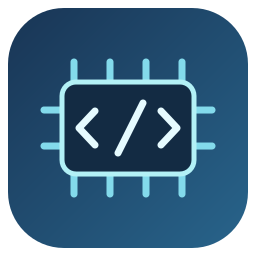
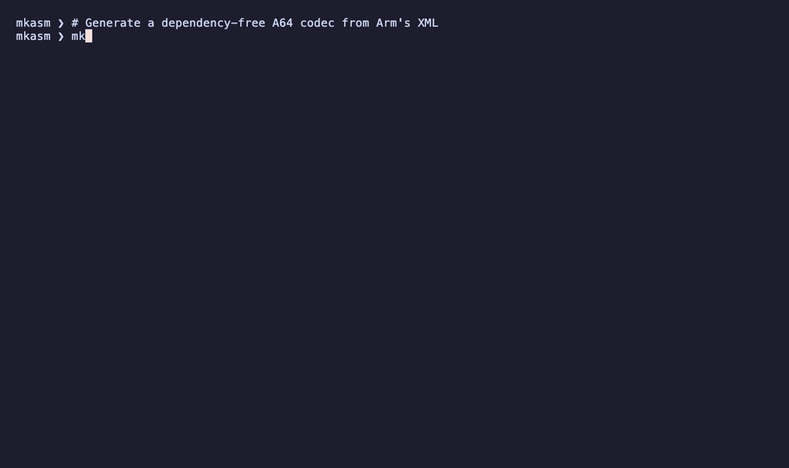

<p align="center"></p>
<h1 align="center">mkasm</h1>
<p align="center"><strong>Turn instruction specifications into codecs you can ship.</strong></p>
<p align="center">
<a href="https://github.com/bryanmatteson/mkasm/actions"></a>

<a href="LICENSE"></a>
</p>

`mkasm` generates instruction-set codecs from machine-readable specifications.
From Arm's A64 XML release it writes a Rust crate or a Go module. From the
AArch32 XML it writes a Rust codec for A32 and Thumb (16 and 32 bits). From an
opcodesDB v3 export it writes an x86-64 Rust crate. Generated projects have no
dependencies, build on their own, and ship with their own tests.

`mkasm --json` writes the resolved instruction model instead of code.

<p align="center"></p>

The demo generates a complete Go module from the June 2026 A64 corpus, then
uses its exact encoder and decision-tree decoder to round-trip `ADD x0, x1,
#42`. Both generation and the codec calls are real. The
[recording script](scripts/record-readme-demo.py) reproduces the session.

| Output | Built from | Provides |
|---|---|---|
| A64 Rust crate | Arm A64 XML | A typed assembler with labels, an exact encoder for every encoding, an allocation-free decision-tree decoder, a disassembler that prints Arm's preferred spelling, and the encoding registry |
| A32/Thumb Rust crate | Arm AArch32 XML | Separate mode-specific decision-tree decoders, exact field encoders, structured operands, branch targets, and assembly formatting in both byte orders |
| A64 Go module | Arm A64 XML | Typed and exact encoders, a decision-tree decoder with a table fallback, and the encoding registry |
| x86-64 Rust crate | opcodesDB v3 JSON | An allocation-free decoder for legacy/REX, 3DNow, VEX, XOP and EVEX with structured operands, Intel-syntax formatting, flow-control and access summaries, exact encoding, and RIP/relative relocation |

## Built for tools that understand machine code

- 🧩 **One specification, several surfaces.** Resolve encoding patterns,
  fields, operand shapes, aliases, features, and instruction classes into one
  model; emit Rust, Go, or inspectable JSON.
- ⚙️ **Encode at the right level.** Use typed A64 assembler calls and labels,
  exact field encoders, or raw emitters for forms whose operands need direct
  control. Fixups resolve branches when the assembler finishes.
- 🔎 **Decode and explain.** Identify an encoding, inspect its fields and
  structured operands, recover branch targets and access information, and
  format the preferred assembly spelling.
- 🧱 **Keep the runtime small.** Generated projects stand alone with no
  dependencies. Rust decision-tree decoders and the x86 codec use fixed-size,
  allocation-free paths.
- 🔁 **Move and edit x86 instructions.** Preserve RIP-relative and branch
  targets through relocation; edit decoded operands through `FormInstruction`
  and encode the selected form again.
- 📦 **Bring your corpus.** Read a directory, archive, URL, or stream with
  bounded loading and deterministic output. The generated registry and tests
  accompany the codec.


<details>
<summary><strong>Corpus coverage and independent validation</strong></summary>


Measured on 2026-10-06 against `ISA_A64_xml_A_profile-2026-06` and opcodesDB
v3, with Apple clang 21.0.0 and Homebrew LLVM MC 22.1.8 as the independent
assemblers:

| Check | Result |
|---|---|
| A64 encoding index | 4,334 canonical encodings and 291 aliases |
| Encodings resolved from their instruction pages | 4,623 of 4,623 |
| Exact encoders, Go and Rust | 4,623 each; every encoding exactly once |
| LLVM byte parity, exact encoders (Go and Rust) | 4,618 of the 4,618 that LLVM recognizes |
| LLVM byte parity, typed Rust calls | 4,523 of the 4,523 that LLVM recognizes |
| LLVM byte parity, disassembly text | 4,573 of the 4,573 that LLVM recognizes |
| x86 opcodesDB import | 3,509 encoding records, 7,289 syntax forms |
| Generated Go, Rust and x86 Rust project tests | Passing |

Every measured A64 case LLVM accepts matches byte for byte, and LLVM rejects
no measured A64 spelling. LLVM MC 22.1.8 does not recognize five encodings: `HINTE` and the
authenticated PC-relative `RETAASPPC`, `RETABSPPC`, `AUTIASPPC` and
`AUTIBSPPC`. They remain unverified, so the
strict all-encoding gate stays red until an independent assembler accepts them.
The full ledger is in [`tests/conformance`](tests/conformance/README.md).

</details>

## Quick start

`mkasm` needs Go 1.24.2 or newer.

```bash
go install github.com/bryanmatteson/mkasm/cmd/mkasm@latest

CORPUS='https://developer.arm.com/-/cdn-downloads/permalink/Exploration-Tools-A64-ISA/ISA_A64/ISA_A64_xml_A_profile-2026-06.tar.gz'

mkasm --codegen rust --output ./aarch64-rs "$CORPUS"
mkasm --codegen go --output ./aarch64-go "$CORPUS"
mkasm --json "$CORPUS" > arm-ir.json
```

For x86-64, pass the `x86.json` that
[opcodesDB](https://github.com/MahdiSafsafi/opcodesDB)'s `x86.pl` writes, or
pipe a compressed copy through `xz`:

```bash
xz -dc x86_64.json.xz | mkasm --arch x86_64 --codegen rust --output ./x86_64-rs -
```

From a source checkout, use `go run ./cmd/mkasm` in place of `mkasm`.

For A32 and Thumb, use the AArch32 corpus. The `arm32` crate includes both
instruction states; `--arch thumb`, `a32`, `arm`, and `aarch32` are aliases.

```bash
mkasm --arch arm32 --codegen rust --output ./arm32-rs \
  https://developer.arm.com/-/cdn-downloads/permalink/Exploration-Tools-AArch32-ISA/ISA_AArch32/ISA_AArch32_xml_A_profile-2026-06.tar.gz
```

```rust
use arm32::{decode, Mode, Endian};
let call = decode(&[0x00, 0xf0, 0x00, 0xf8], Mode::Thumb, Endian::Little).unwrap();
assert_eq!(call.length, 4);
assert_eq!(call.branch_target(0x2002), Some(0x2006));
assert_eq!(call.format(0x2002).unwrap(), "bl #0x2006");
let operands = call.details(0x2002).unwrap();
```

AArch32 generation supports Rust. `--json` includes each instruction's
`instruction_set` (`A32` or `T32`) and `width`. A32 fetches a word; Thumb32
fetches two halfwords in architectural order. A truncated Thumb32 prefix is
reported as truncated, never reinterpreted as a Thumb16 instruction.
Formatting is stateless and uses the spelling outside an IT block; an analyst
can track ITSTATE separately. Allocated instructions without an exact state
transition in a consumer can still use their decoded operands and encoding ID.
The June 2026 AArch32 corpus resolves 2,363 encodings, including 143 aliases.
Generated crate tests cover field round trips, byte order, branch targets,
integer and SIMD formatting, and structured register and memory access.

## Using the generated code

The A64 crate assembles with typed operands, decodes a word to its encoding,
and prints the spelling Arm's XML prefers:

```rust
use aarch64::*;

let mut asm = Assembler::new();
asm.ldr(X2, Mem::offset(X1, 16));
asm.add(X0, X2, 8);
asm.ret();
let code = asm.finish().unwrap();
assert_eq!(code, [0xf9400822, 0x91002040, 0xd65f03c0]);

let insn = decode(0x53083d00).unwrap();
assert_eq!(insn.encoding_id, "UBFM_32M_bitfield");
assert_eq!(insn.format(0).unwrap(), "UBFX w0, w8, #8, #8");

// Every encoding also has an exact encoder over its fields.
let word = encode_with_fields(
    "UBFM_32M_bitfield",
    &[("immr", 8), ("imms", 15), ("Rn", 8), ("Rd", 0)],
)
.unwrap();
assert_eq!(word, 0x53083d00);
```

A decoded instruction also carries its assembler mnemonic, its field values,
and any other encodings that match the same word. `catalog_entry` lists the
decoder's encodings in a stable order.

The x86-64 crate decodes into fixed-size values and can move an instruction
without changing its target:

```rust
use x86_64::*;

let bytes = [0xff, 0x15, 0x00, 0x20, 0x00, 0x00];
let insn = decode(&bytes, Mode::Mode64).unwrap();
assert_eq!(insn.format_intel(0x1000), "call qword ptr [rip+0x2000]");
assert_eq!(insn.flow_control(), FlowControl::IndirectCall);

let mut moved = [0u8; 15];
let len = relocate(&insn, &bytes, 0x1000, 0x5000, &mut moved).unwrap();
let moved = decode(&moved[..len], Mode::Mode64).unwrap();
assert_eq!(moved.format_intel(0x5000), "call qword ptr [rip-0x2000]");
```

`encoding_count`, `encoding_supports_mode` and `encode_representative` walk
every form. `FormInstruction` changes a decoded instruction's operands and
encodes it again.

## Command line

```text
mkasm [--arch aarch64|arm32|x86_64] --codegen rust --output DIR INPUT
mkasm [--arch aarch64]        --codegen go   --output DIR INPUT
mkasm [--arch aarch64|arm32|x86_64] --json INPUT
mkasm --version
mkasm --help
```

For A64, `INPUT` is an extracted XML directory, a `.tar` or `.tar.gz` file, an
HTTP(S) URL, or `-` for a tar stream on stdin. For x86-64 it is uncompressed
opcodesDB v3 JSON from a file, a URL or stdin. An `.xz` input is refused with
the `xz -dc` command to run instead. `--arch` also accepts `arm64`, `arm64e`,
`amd64`, `x86-64` and `x64`.

- Progress and statistics go to stderr.
- `--json` writes only JSON to stdout: schema `mkasm.ir.v1` for A64, sorted by
  encoding ID, and `mkasm.x86.v1` for x86-64.
- `--codegen` writes only below `--output` and leaves stdout empty.
- Invalid flags exit with status 2 and print the help text after the error on
  stderr. Input, parse, validation and generation failures exit with status 1.
- No arguments, `-h` or `--help` print the help text to stdout.

## How it works

### A64

```text
directory | .tar | .tar.gz | URL | stdin
                    |
            bounded corpus loader
                    |
  Pass 1   encodingindex.xml -> encoding index
                    |
  Pass 2   instruction pages, in parallel -> resolved IR
                    |
               validation
              /          \
      --json export    Pass 3: decoder tree, typed operands,
                       disassembly forms -> Go | Rust
```

The loader streams a compressed corpus in one pass:

- gzip and tar are read sequentially, and nothing is extracted to disk;
- a bounded worker pool parses the XML members under a 32 MiB budget for
  expanded XML in flight;
- compact parsed instruction pages are kept instead of raw XML, and
  `encodingindex.xml` is released after Pass 1;
- members larger than 64 MiB, or archives that expand beyond 512 MiB, are
  rejected as malformed.

Arm release bundles can hold both the previous and the current corpus. For a
named archive, `mkasm` reads the dated root the archive name gives and skips the
older one. On stdin it picks the newest root only when every root belongs to
one dated release series; unrelated roots are an error, never merged. The
similarly named `AARCHMRS_A_profile-*` archives carry Arm's JSON model rather
than the instruction XML, and `mkasm` rejects them with a diagnostic saying so.

### Preferred disassembly

Arm's XML gives each alias (`UBFX`, `LSL`, `MOV`, `CMP` and so on) its own
encoding, with an `aliascond` stating when the alias is the preferred
disassembly. `mkasm` compiles each condition into checks on the decoded word,
and the formatter prints the most specific form whose checks hold. Compiled
conditions:

- fixed field values;
- field equalities, including `x + 1 == y`;
- `BitCount(x) == 1`;
- `MoveWidePreferred` and `SVEMoveMaskPreferred`;
- the bitfield orders `UInt(imms) < UInt(immr)` and `UInt(imms) >= UInt(immr)`;
- `BFXPreferred`.

The decoder reports `0x53083d00` as `UBFM_32M_bitfield`, and the formatter
prints it as `UBFX w0, w8, #8, #8`. Words that `UBFIZ`, `LSL`, `LSR`, `ASR`,
`UXT*`, `SXT*`, `BFI`, `BFC` or `BFXIL` describe print with those names.

### x86-64

Every template of every opcodesDB `ENCODING` record becomes one syntax form.
The generated decoder normalizes legacy and vector prefixes once, then indexes a
fixed prefix-family/map/opcode table. Each bucket checks only its own mode,
prefix, ModR/M and trailing-byte-width constraints. Decoding returns a
fixed-size value and encoding writes into the caller's 15-byte buffer. Neither
allocates.

## Generated projects

Generated projects are build outputs. To change one, change the generator or
its templates and regenerate rather than editing the output.

A64 Rust:

```text
aarch64-rs/
  Cargo.toml, LICENSE
  src/
    lib.rs                public API
    asm_support.rs        Assembler, registers, memory operands, labels, errors
    insns.rs              typed methods, one per mnemonic across its operand shapes
    encodings.rs          exact encoders, one per Arm encoding ID
    raw.rs                field-level emitters for encodings without typed operands
    encoders.rs           encode_fixed and encode_with_fields by encoding ID
    decoders.rs           decision-tree decode and the decoder catalog
    formatters.rs         preferred-spelling disassembly
    registry.rs           encoding registry
    insns_test.rs         typed-surface tests
  tests/
    conformance.rs        typed-call ledger for the LLVM gate
    exact_conformance.rs  all-encoding ledger for the LLVM gate
  examples/
    hello.rs              worked assembler example
    llvm_check.rs         operand placements checked against clang
    decode_bench.rs       decode time and allocation count
```

A64 Go (module `aarch64`, Go 1.22):

```text
aarch64-go/
  go.mod, LICENSE
  encoders/     InstructionEncoder.Encode, EncodeFixed, EncodeWithFields
  decoders/     Decode, DecodeTree and DecodeTable, with golden and round-trip tests
  registry/     Lookup by encoding ID
  conformance/  all-encoding ledger for the LLVM gate
```

The Go module has no disassembler.

x86-64 Rust:

```text
x86_64-rs/
  Cargo.toml, LICENSE
  src/lib.rs              decoder, Intel formatter, encoders, relocation, tests
  examples/decode_bench.rs
```

The Rust crates use edition 2021 and are tested on Rust 1.97.1.

## Development

Day-to-day work needs Go and `make`. Generated-project targets also need
`cargo`. LLVM gates need `clang` and `llvm-mc`. x86 targets need `xz`.
`make help` lists every target.

| Target | Checks |
|---|---|
| `make verify` | gofmt, vet, unit and race tests, source-coverage floors, and exact-ledger coverage |
| `make generate-go`, `generate-rust`, `generate-x86-rust` | generate a project and run its tests (`-D warnings` for Rust) |
| `make conformance` | Go, Rust and disassembly byte parity against clang and LLVM MC |
| `make conformance-strict` | the same, but LLVM must also recognize every encoding |
| `make conformance-asl` | opcode bits and fields against Arm's ASL |
| `make bench`, `bench-micro`, `bench-rust-decoder`, `bench-x86`, `bench-x86-rust` | benchmarks; see [`tests/benchmarks`](tests/benchmarks/README.md) |
| `make release-check` | verify, build, all three generated projects, then `conformance` |
| `make build` | a packaged release binary in `dist/` |

Variables:

- `CORPUS`: an A64 archive path or URL. It defaults to the download URL for
  Arm's 2026-06 release; point it at a local copy to work offline.
- `X86_CORPUS`: an opcodesDB `.json.xz` file; required by the x86 targets.
- `ASL`: an Arm ASL directory; defaults to `../arm-asl-parser/asl`.
- `MKASM_CLANG` and `MKASM_LLVM_MC`: override the independent assemblers.
- `GO_OUT`, `RUST_OUT` and `X86_RUST_OUT`: generated-project directories.

`make conformance` fails on any rejected spelling or byte mismatch. Encodings
the installed LLVM does not recognize are listed but never counted as passing.
`make conformance-strict` answers the separate question of whether that LLVM can
verify the whole corpus. `make audit-disasm` is a coverage-threshold report, not
a conformance gate. `make coverage-encodings` proves that each exact ledger
contains every resolved encoding exactly once. Source statement coverage, a
separate measure, has its floors in [`.testcoverage.yml`](.testcoverage.yml).

[`mise.toml`](mise.toml) provides the same workflows with pinned Go 1.26.5 and
Rust 1.97.1. Each task's name is the make target's name with `:` for `-`, so
`make conformance-strict-go` becomes `mise run conformance:strict:go`.

### Releases

```bash
make release-check X86_CORPUS=/path/to/x86_64.json.xz
make build VERSION=v0.1.0
./dist/mkasm --version
```

`make build` writes a stripped, path-trimmed binary to `dist/`. Next to it go a
`.tar.gz` archive of `mkasm`, `LICENSE` and `README.md`, and that archive's
SHA-256 checksum. Without `VERSION`, the build embeds the `git describe`
output. Set `GOOS` and `GOARCH` to package for another platform.

## Repository map

| Path | Responsibility |
|---|---|
| [`cmd/mkasm`](cmd/mkasm) | CLI, input selection and JSON export |
| [`pkg/arm`](pkg/arm) | A64 and AArch32 corpus loading, instruction-page parsing, alias conditions, disassembly model, and code generation |
| [`pkg/x86`](pkg/x86) | opcodesDB import, x86 encode/decode core, and Rust generation |
| [`pkg/parse`](pkg/parse) | Streaming XML event engine |
| [`pkg/ir`](pkg/ir) | Architecture-neutral instruction and bit-field model |
| [`pkg/decoder`](pkg/decoder) | Decoder-tree construction and matching |
| [`pkg/asl`](pkg/asl) | Arm ASL parser for independent cross-checks |
| [`pkg/coverage`](pkg/coverage) | Expected-versus-emitted encoding coverage |
| [`templates`](templates) | Embedded Go, Rust and x86 Rust project templates |
| [`tests/conformance`](tests/conformance) | LLVM and ASL verification and the current ledger |
| [`tests/benchmarks`](tests/benchmarks) | Corpus-scale benchmarks and measured results |
| [`Makefile`](Makefile), [`mise.toml`](mise.toml) | Verification and release workflows |

## Scope

`mkasm` generates A64 Go and Rust projects, A32/Thumb Rust projects, and x86-64 Rust projects. The x86
backend does not emit Go and does not model MVEX. It does cover 3DNow's
trailing-selector encoding. `mkasm` does not execute architecture pseudocode or
stand in for a simulator. Round trips between its own encoders and decoders
show internal consistency, so only the independent gates count as conformance
evidence.

Arm's corpus is not redistributed here. Users download it or supply their own
copy. Generated projects are build outputs and are not committed.

## License

MIT. Generated Go modules and Rust crates carry the same license.
